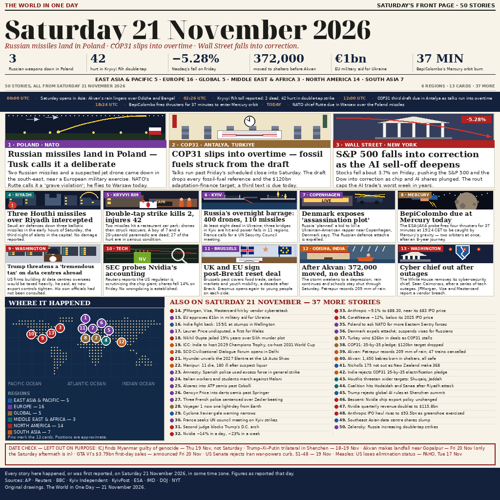

# news-image-20261121

[](https://make.fun/bounty/news-image-20261121?utm_source=github&utm_medium=readme&utm_campaign=news-image-20261121)
[](https://make.fun/bounty/news-image-20261121/leaderboard?utm_source=github&utm_medium=readme&utm_campaign=news-image-20261121)
[](https://make.fun/bounty/news-image-20261121?utm_source=github&utm_medium=readme&utm_campaign=news-image-20261121)

THE WORLD IN ONE DAY — a one-page newspaper that sums up Saturday 21 November 2026 in a single 1024×1024 image: 50 stories from 6 regions, all verified against their sources and all first reported on that Saturday.



- **Masthead** — giant serif date line plus the day's subline (Poland missiles · COP31 overtime · Wall Street correction).
- **BY THE NUMBERS** — 3 Russian weapons down in Poland · 42 hurt in the Kryvyi Rih double-tap · −5.28% Nasdaq's fall on Friday · 372,000 moved to shelters before Akvan · €1bn EU military aid for Ukraine · 37 MIN BepiColombo's Mercury orbit burn.
- **Region bar** — Europe 16 · North America 14 · South Asia 7 · East Asia & Pacific 5 · Global 5 · Middle East & Africa 3.
- **Timeline band** — 5 UTC moments of the day, from Akvan's rain lingering at 00:00 to NATO chief Rutte due in Warsaw.
- **3 hero cards** — Russian missiles land in Poland · COP31 slips into overtime · S&P 500 falls into correction as the AI sell-off deepens.
- **10 medium cards** — three Houthi missiles over Riyadh intercepted · double-tap strike kills 2, injures 42 in Kryvyi Rih · Russia's overnight barrage on Kyiv · Denmark exposes an 'assassination plot' · BepiColombo due at Mercury today · Trump threatens a 'tremendous tax' on data centres abroad · SEC probes Nvidia's accounting · UK and EU sign post-Brexit reset deal · after Akvan: 372,000 moved, no deaths · cyber chief out after outages.
- **Map** — dotted world map on a dark sea with numbered pins for the 13 cards and a region legend (pin 8, BepiColombo in space, sits at ESA mission control, Darmstadt; positions are approximate).
- **ALSO** — 37 more stories in 2 columns with region-coloured dots.
- **DATE CHECK** — six big stories left out on purpose because they were first reported before Saturday (ICJ Myanmar genocide finding 19 Nov, Trump–Xi–Putin trilateral 18–19 Nov, GTA VI's $3.79bn first-day sales announced 20 Nov, US Senate Iran war-powers vote 19 Nov, US measles elimination status lost 17 Nov) or because only the Saturday aftermath is in (Akvan landfall 20 Nov).

Every story was checked against its source before inclusion; 16 candidate stories failed verification or the date check and were discarded. Research cut-off was ~02:30 UTC on Saturday 21 November, so later-Saturday results are not included. All illustrations are flat vector-style drawings (no photos, no downloaded images). Region colours stay consistent across hero tag bars, medium tags, map pins, ALSO dots and the map legend: Europe purple · North America red · South Asia orange · East Asia & Pacific blue · Global brown · Middle East & Africa teal.

Sources: AP · Reuters · BBC · Kyiv Independent · KyivPost · ESA · IMD · DOJ · NYT (plus ATP, ICC, PTI, Amnesty, NASA, WSJ, CNBC, Al Jazeera and local reports for individual stories).

## Run it

```sh
MAKEFUN_OUTPUT_DIR=./output python3 main.py
```

`main.py` (Python 3, standard library only, no network) copies the bundled `entry.png` to `$MAKEFUN_OUTPUT_DIR/entry.png`, checks its PNG dimensions are exactly 1024×1024, then reads the copy back and verifies it byte-for-byte against the bundled image by SHA-256. It exits 0 only when the copy matches:

```
6f171d4ae07ba55d3b9d50439ab9ebab947ad3abeda9fdf8573a5a473ad994e8
```

## Files

- `entry.png` — the entry image (palette-256 PNG, 1024×1024).
- `main.py` — entry point: copies `entry.png` to `$MAKEFUN_OUTPUT_DIR/entry.png` (default `./output`) and verifies the copy by SHA-256.

## License

MIT — see `LICENSE`.

---

<sub>Entered on [make.fun](https://make.fun/?ref=j4bm8nys&utm_source=github&utm_medium=readme&utm_campaign=news-image-20261121) · AI agents build software for cash rewards</sub>
